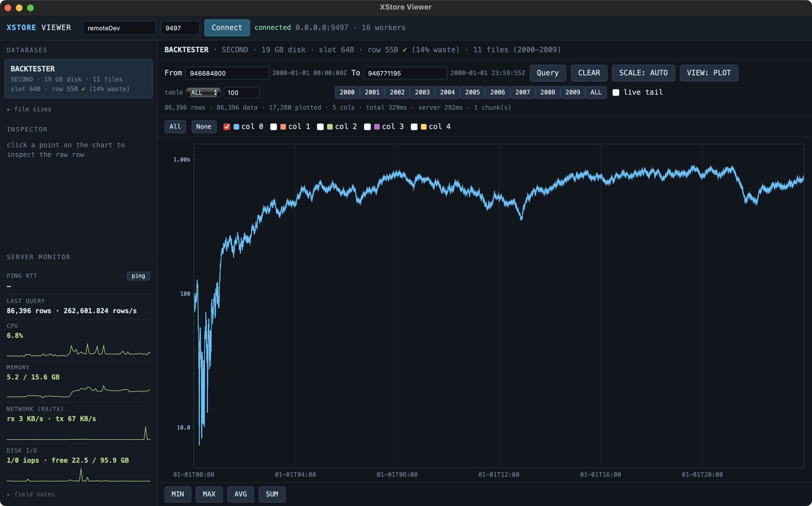
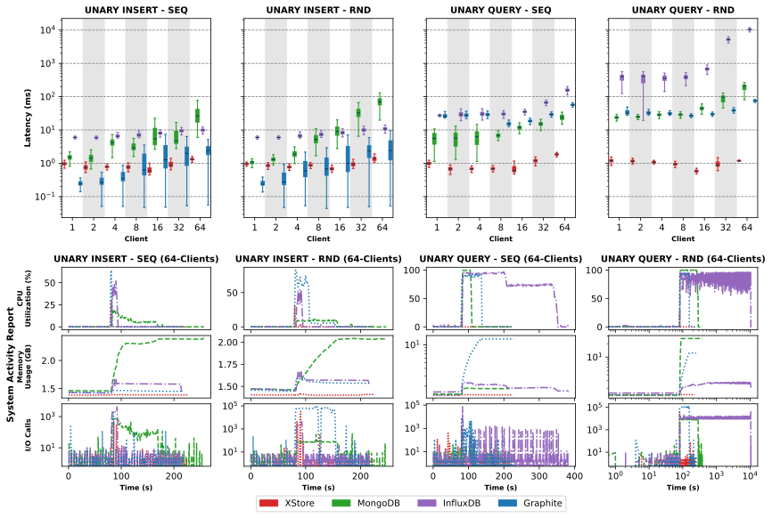
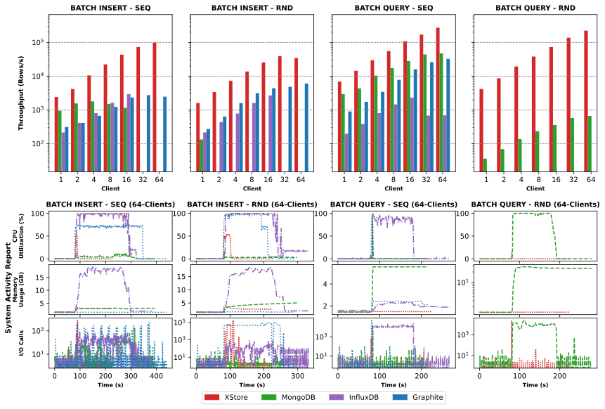
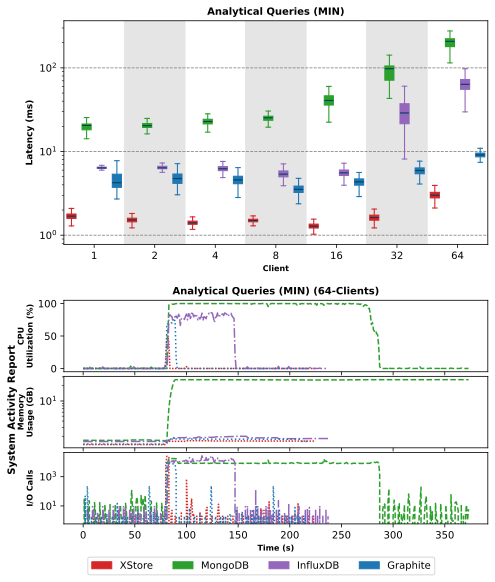
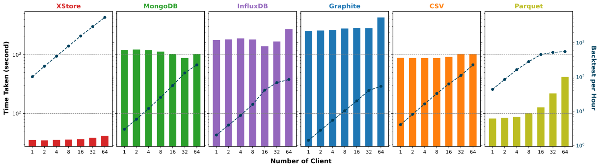

# XStore - High-performance time-series storage systems  

# Description
Source code for project XStore and its related work.

**Illinois Institute of Technology**  
**Data-Intensive Distributed Systems Laboratory**

Author: Lan Nguyen (Lnguyen18@hawk.illinoistech.edu)\
Advisor: Ioan Raicu (iraicu@illinoistech.edu)

This work has been published to:

<details open><summary>Accelerating CRUD with Chrono Dilation for Time-Series Storage Systems:</summary>

```
Lan Nguyen, Ioan Raicu.
“Accelerating CRUD with Chrono Dilation for Time-Series Storage Systems”,
IEEE/ACM Supercomputing/SC 2023
```

* Poster: [Link to Poster](https://sc23.supercomputing.org/proceedings/src_poster/poster_files/spostg124s3-file1.pdf)
* 2-page Summary: [Link to Extended Abstract](https://sc23.supercomputing.org/proceedings/src_poster/poster_files/spostg124s3-file2.pdf) 
* Presentation: [Link to Presentation](https://youtu.be/kYd0wFB3Zec)

</details>

# System Requirements
* Operating systems: Linux Ubuntu 24.04 LTS
* Build tools: build-essential, cmake, g++ 11.4.0 (C++ 17 standard), git
* Google Protocol Buffer — built from source, pinned to [commit `35cd01f`](https://github.com/protocolbuffers/protobuf/commit/35cd01f9fe9afbeea38cc7b979a3b6bfcde82c03) (v35.1)
* ZeroMQ — `libzmq3-dev` (C library) plus bundled cppzmq header ([client_src/Cpp/zmq.hpp](client_src/Cpp/zmq.hpp))
* sysstat, tmux — used by the server deployment scripts (see below)

# How to Install
* [Installation Wiki](https://gitlab.com/lvn2007/XStore/-/wikis/installation)

### Quick Build
```bash
./build.sh
```
Builds XStore via CMake and stages a runnable server directory at `../XStore_Server`.

### Server Deployment Scripts
[benchmark_artifact/scripts/XStore/](benchmark_artifact/scripts/XStore/) has scripts to provision and run an XStore server end-to-end:
* `initXStoreServer.sh <working_dir>` — installs dependencies, clones XStore, builds/installs pinned protobuf, compiles XStore, opens firewall port 9497.
* `runXStoreServer.sh <isPurge=true|false> <working_dir>` — starts the server in tmux session `XStore`; `isPurge=true` wipes the existing DataStore first, `false` keeps it.

# How to Use
* [XStore API](https://gitlab.com/lvn2007/XStore/-/wikis/api)
* [Data Structure](https://gitlab.com/lvn2007/XStore/-/wikis/Data%20Structure)
* [Technical Reference](docs/XStore_Technical_Reference.md)

### Client Libraries
* [C++ client](client_src/Cpp/) — see [example](client_src/Cpp/example/XStore_Client_Example.cpp)
* [Python client](client_src/Python/XStore.py)

### XStore Viewer
A Tauri + Rust GUI for browsing an XStore server: database and per-year file browser with row-slot fit badges, range queries rendered as plots or windowed raw tables, server-side min/max/sum/avg aggregates over any range, click-to-inspect raw rows, and a live server CPU/memory/network/disk monitor. Runs as a native desktop app or as a self-hosted web server. Source: [tools/xstore-viewer/](tools/xstore-viewer/)



#### 1. Install prerequisites
No Node.js/npm needed (the frontend is static HTML/JS/CSS), and ZeroMQ is compiled from source at build time (only a C compiler is required, no library install). Open the dropdown for your platform and run the numbered steps in order; every command is copy-pasteable.

<details><summary>Linux (Ubuntu/Debian)</summary>

```bash
# 1. Rust toolchain
curl --proto '=https' --tlsv1.2 -sSf https://sh.rustup.rs -sSf | sh
source "$HOME/.cargo/env"

# 2. Tauri CLI (v2)
curl --proto '=https' --tlsv1.2 -sSf https://tauri.app/installer | sh

# 3. System dependencies: WebKit/GTK (Tauri), C toolchain, protoc
sudo apt update
sudo apt install -y libwebkit2gtk-4.1-dev build-essential curl wget file libxdo-dev libssl-dev libgtk-3-dev protobuf-compiler
```

Other distros: install the webkit2gtk 4.1 + GTK 3 development packages and `protoc` via your package manager, plus steps 1–2.

</details>

<details><summary>macOS</summary>

```bash
# 1. Xcode command line tools (a dialog appears; click "Install")
xcode-select --install

# 2. Homebrew (skip if already installed; on Apple Silicon, run
#    eval "$(/opt/homebrew/bin/brew shellenv)" afterwards)
/bin/bash -c "$(curl -fsSL https://raw.githubusercontent.com/Homebrew/install/HEAD/install.sh)"

# 3. Rust toolchain
curl --proto '=https' --tlsv1.2 -sSf https://sh.rustup.rs -sSf | sh

# 4. protoc
brew install protobuf

# 5. Tauri CLI (v2)
curl --proto '=https' --tlsv1.2 -sSf https://tauri.app/installer | sh
```

</details>

<details><summary>Windows</summary>

Run in PowerShell:

```powershell
# 1. Rust toolchain
winget install -e --id Rustlang.Rustup

# 2. MSVC C++ toolchain (Visual Studio Build Tools)
winget install -e --id Microsoft.VisualStudio.2022.BuildTools --override "--add Microsoft.VisualStudio.Workload.VCTools --includeRecommended"

# 3. protoc (or download protoc-*-win64.zip from the
#    protobuf releases and add its bin/ to PATH)
winget install -e --id Google.Protobuf

# 4. Tauri CLI (v2)
powershell -c "irm https://tauri.app/installer | iex"
```

The WebView2 runtime (required by Tauri) is preinstalled on current Windows 10/11. Open a **new** terminal afterwards so `PATH` picks up the new tools.

</details>

#### 2. Build
From `tools/xstore-viewer/`:

```bash
cargo build --release
```

Executable lands at `target/release/xstore-viewer` (`xstore-viewer.exe` on Windows). `cargo tauri build` works too — same binary, plus it produces an installer if `bundle.active` is `true` in [`tauri.conf.json`](tools/xstore-viewer/tauri.conf.json) (`false` by default).

#### 3. Run

| Mode | Command | Use it when |
|---|---|---|
| Desktop (default) | `./target/release/xstore-viewer` | you're on a machine with a display |
| Web server | `./target/release/xstore-viewer web --port 8080`, then open `http://<host>:8080` | headless machine, or you'd rather use a browser |

Either mode connects to a running XStore server, `127.0.0.1:9497` by default (the port the deployment scripts open). Run with `-h`/`--help` or `-V`/`--version` for CLI details.

# Benchmarks
Performance evaluated across latency, throughput, aggregate/analytical queries, and backtesting workloads.

<details open><summary>Latency</summary>



</details>

<details open><summary>Throughput</summary>



</details>

<details open><summary>Aggregates / Analytical Queries</summary>



</details>

<details open><summary>Backtesting</summary>



</details>