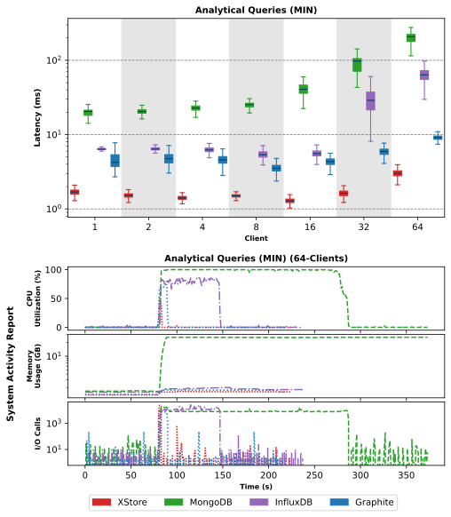

# XStore - High-performance time-series storage systems  

# Description
Source code for project XStore and its related work.

**Illinois Institute of Technology**  
**Data-Intensive Distributed Systems Laboratory**

Author: Lan Nguyen (Lnguyen18@hawk.illinoistech.edu)\
Advisor: Ioan Raicu (iraicu@illinoistech.edu)

This work has been published to:

<details open><summary>Accelerating CRUD with Chrono Dilation for Time-Series Storage Systems:</summary>

```
Lan Nguyen, Ioan Raicu.
“Accelerating CRUD with Chrono Dilation for Time-Series Storage Systems”,
IEEE/ACM Supercomputing/SC 2023
```

* Poster: [Link to Poster](https://sc23.supercomputing.org/proceedings/src_poster/poster_files/spostg124s3-file1.pdf)
* 2-page Summary: [Link to Extended Abstract](https://sc23.supercomputing.org/proceedings/src_poster/poster_files/spostg124s3-file2.pdf) 
* Presentation: [Link to Presentation](https://youtu.be/kYd0wFB3Zec)

</details>

# System Requirements
* Operating systems: Linux Ubuntu 24.04 LTS
* Build tools: build-essential, cmake, g++ 11.4.0 (C++ 17 standard), git
* Google Protocol Buffer — built from source, pinned to [commit `35cd01f`](https://github.com/protocolbuffers/protobuf/commit/35cd01f9fe9afbeea38cc7b979a3b6bfcde82c03) (v35.1)
* ZeroMQ — `libzmq3-dev` (C library) plus bundled cppzmq header ([ClientSrc/Cpp/zmq.hpp](ClientSrc/Cpp/zmq.hpp))
* sysstat, tmux — used by the server deployment scripts (see below)

# How to Install
* [Installation Wiki](https://gitlab.com/lvn2007/XStore/-/wikis/installation)

### Quick Build
```bash
./build.sh
```
Builds XStore via CMake and stages a runnable server directory at `../XStore_Server`.

### Server Deployment Scripts
[BenchmarkArtifacts/scripts/XStore/](BenchmarkArtifacts/scripts/XStore/) has scripts to provision and run an XStore server end-to-end:
* `initXStoreServer.sh <working_dir>` — installs dependencies, clones XStore, builds/installs pinned protobuf, compiles XStore, opens firewall port 9497.
* `runXStoreServer.sh <isPurge=true|false> <working_dir>` — starts the server in tmux session `XStore`; `isPurge=true` wipes the existing DataStore first, `false` keeps it.

# How to Use
* [XStore API](https://gitlab.com/lvn2007/XStore/-/wikis/api)
* [Data Structure](https://gitlab.com/lvn2007/XStore/-/wikis/Data%20Structure)
* [Technical Reference](docs/XStore_Technical_Reference.md)

### Client Libraries
* [C++ client](ClientSrc/Cpp/) — see [example](ClientSrc/Cpp/example/XStore_Client_Example.cpp)
* [Python client](ClientSrc/Python/XStore.py)

# Benchmarks
Performance evaluated across latency, throughput, aggregate/analytical queries, and backtesting workloads.

<details open><summary>Latency</summary>


</details>

<details open><summary>Throughput</summary>


</details>

<details open><summary>Aggregates / Analytical Queries</summary>



</details>

<details open><summary>Backtesting</summary>


</details>